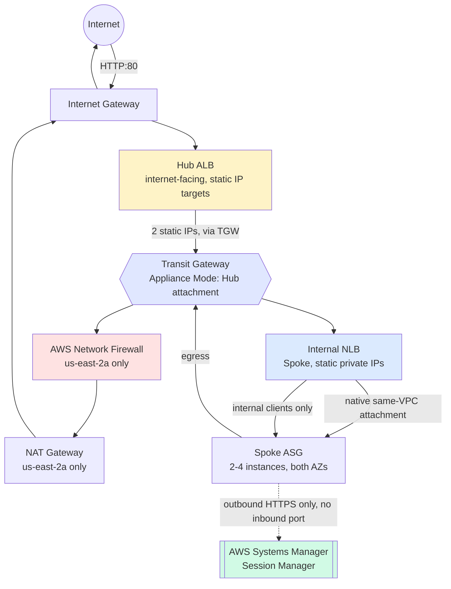

# Architecture

## Logical Architecture



## VPC Architecture

| VPC | CIDR | Subnets | Internet Gateway |
|---|---|---|---|
| Hub | `10.0.0.0/16` | tgw-a, tgw-b, nat, firewall, alb-a, alb-b, bastion (unused) | **Yes** (only VPC with one) |
| Spoke | `10.1.0.0/16` | app-a, app-b, rds-a, rds-b (unused), tgw-a, tgw-b | **No** (never) |

## Subnet Architecture

**Hub** (`modules/vpc` called with `create_internet_gateway = true`):

| Subnet | CIDR | AZ | Purpose |
|---|---|---|---|
| tgw-a | `10.0.1.0/28` | a | TGW attachment ENI |
| tgw-b | `10.0.2.0/28` | b | TGW attachment ENI |
| nat | `10.0.3.0/28` | a | NAT Gateway |
| firewall | `10.0.4.0/28` | a | AWS Network Firewall endpoint |
| alb-a | `10.0.5.0/28` | a | ALB ENI |
| alb-b | `10.0.6.0/28` | b | ALB ENI |
| bastion | `10.0.7.0/28` | b | **Reserved, unused** - see "SSM instead of Bastion" |

**Spoke** (`create_internet_gateway = false`):

| Subnet | CIDR | AZ | Purpose |
|---|---|---|---|
| app-a | `10.1.1.0/24` | a | ASG instances, NLB ENI (static IP) |
| app-b | `10.1.2.0/24` | b | ASG instances, NLB ENI (static IP) |
| rds-a | `10.1.3.0/24` | a | **Reserved, unused** - see README "Reference Diagram Additions Not Yet Implemented" |
| rds-b | `10.1.4.0/24` | b | **Reserved, unused** |
| tgw-a | `10.1.5.0/28` | a | TGW attachment ENI |
| tgw-b | `10.1.6.0/28` | b | TGW attachment ENI |

### SSM instead of Bastion

There is no Bastion instance anywhere in this platform, and no SSH port
open on any security group. The Hub's `bastion` subnet is still created
(matching the reference diagram's layout) but nothing is deployed into it.
Administrative access to Spoke instances is entirely via **AWS Systems
Manager Session Manager** - see `README.md` "SSM instead of Bastion" for
the exact command and the IAM/networking reasoning.

### Single-AZ Firewall/NAT - an honest trade-off

The reference architecture places the firewall and NAT subnets only in
`us-east-2a`. This is preserved exactly as specified rather than "improved"
to dual-AZ. The operational consequence: **`us-east-2a` is a single point
of failure for all Spoke internet egress and all Hub-inbound ALB traffic
reaching Spoke targets.** See `OPERATIONS.md` "Future Improvements" for the
natural dual-AZ extension.

## Transit Gateway Architecture

One Transit Gateway, ASN `64512`, two VPC attachments:

- **Hub attachment**: `appliance_mode_support = "enable"` (see
  `modules/transit-gateway/README.md` for the full asymmetric-routing
  explanation), attached via the `tgw-a`/`tgw-b` subnets.
- **Spoke attachment**: normal mode, attached via its own `tgw-a`/`tgw-b`
  subnets.

Both attachments propagate their VPC's CIDR into the TGW's default route
table automatically. One static route, `0.0.0.0/0 -> Hub attachment`, is
added explicitly because a VPC attachment can only ever propagate its own
CIDR, never a default route.

### Why Appliance Mode still matters with a single-AZ firewall

Even though the Network Firewall itself only exists in `us-east-2a`, TGW
Appliance Mode still provides value: without it, the TGW's per-flow ECMP
hash could route a given connection's forward leg through the Hub's
`tgw-a` ENI and its return leg through `tgw-b` ENI. Both ultimately reach
the same firewall endpoint in this single-AZ configuration, but inconsistent
ENI selection still complicates flow-level troubleshooting. If the
firewall/NAT are ever extended to dual-AZ, Appliance Mode becomes strictly
necessary rather than just good hygiene.

## Firewall Architecture

See `modules/network-firewall/README.md` for the full rule-ordering
explanation (SID 5-9, `STRICT_ORDER` at both the rule-group and
firewall-policy level, and the `HOME_NET` IP-set variable covering both
VPCs' CIDRs from one rule definition per SID).

## Routing Flows

### Public ingress (Internet -> Spoke application)

```text
Internet -> IGW -> Hub ALB (alb-a/alb-b) -> [crosses TGW to the Spoke NLB's
  static IP] -> TGW (Appliance Mode pins flow to one Hub AZ) -> Spoke TGW
  subnet -> Spoke app subnet -> internal NLB -> ASG instance:80
```

### Internal ingress (private client -> Spoke application, no ALB involved)

```text
Internal client -> Spoke internal NLB (app-a/app-b ENIs, static IPs) -> NLB
  target group (same-VPC, instance targets) -> ASG instance:80
```

### Outbound egress (Spoke -> Internet)

```text
Spoke ASG instance
  -> spoke-app route table: 0.0.0.0/0 -> TGW
  -> Transit Gateway (Appliance Mode: flow pinned to one Hub AZ)
  -> Hub tgw-a/tgw-b subnet
  -> hub-tgw route table: 0.0.0.0/0 -> Network Firewall endpoint
  -> AWS Network Firewall (stateful inspection: PASS 80/443/53, DROP else)
  -> firewall route table: 0.0.0.0/0 -> NAT Gateway
  -> NAT Gateway
  -> nat route table: 0.0.0.0/0 -> Internet Gateway
  -> Internet Gateway -> Internet
```

### Administrative access (SSM, no Bastion)

```text
Administrator -> AWS Systems Manager Session Manager (aws ssm start-session)
  -> SSM agent on the Spoke instance (outbound-initiated HTTPS connection,
     no inbound port ever opened)
```

## Symmetric Routing (IGW Ingress Routing)

**The problem:** return traffic from the internet, addressed to the NAT
Gateway's public Elastic IP, arrives at the Hub's Internet Gateway. Without
an explicit ingress route, AWS's default IGW behavior routes it straight to
the NAT Gateway's subnet - **completely bypassing the Network Firewall** on
the return leg of every outbound connection.

**The fix:** an **edge association** - a route table associated directly
with the Internet Gateway itself - with one route: traffic destined for the
NAT subnet's CIDR (`10.0.3.0/28`) is sent to the Network Firewall endpoint
first. See `routing.tf`'s `rt_hub_igw_ingress` module call.

## ALB vs NLB - Two Independent Paths, Connected by Static IPs

**These are never to be confused as one being a "backend" of the other in
the sense of application logic** - but architecturally, the ALB's target
*is* the NLB (specifically, its two fixed private IPs), which is what makes
target registration trivial and permanent instead of requiring a dynamic
mechanism.

| | ALB | NLB |
|---|---|---|
| VPC | Hub | Spoke |
| Scheme | internet-facing | internal |
| Listener | HTTP :80 | TCP :80 |
| Target type | `ip` (the NLB's 2 static private IPs) | `instance` (same-VPC ASG) |
| Target registration | Static, one-time, in Terraform (`aws_lb_target_group_attachment`) | Native ASG attachment (`target_group_arns`) |
| Reachable from | The public internet | Only internal/private clients |

A request arriving via the public ALB path flows: `ALB -> NLB -> ASG
instance`. A request arriving via the internal NLB path flows directly:
`NLB -> ASG instance`. Both ultimately reach the same application code.

## Static ALB Target Registration (No Lambda)

An earlier iteration of this design pointed the ALB directly at individual
Spoke ASG instance IPs, which required a Lambda-based dynamic registration
mechanism (ASG lifecycle hooks + EventBridge) because instance IPs
constantly change as the ASG scales or replaces instances.

**This design instead points the ALB at the Spoke NLB's two static private
IPs.** NLBs are guaranteed by AWS to keep the same private IP address(es)
for their entire lifetime - unlike individual EC2 instances. That
permanence means:

- `modules/nlb` assigns fixed IPs via `subnet_mapping.private_ipv4_address`
  (computed once in `locals.tf`, shared with `modules/alb` without either
  module depending on the other's output - avoiding a dependency cycle).
- `modules/alb` registers those two IPs as `aws_lb_target_group_attachment`
  resources, created once, in plain Terraform, and never touched again.
- The NLB's own native, same-VPC ASG attachment (`modules/autoscaling`)
  transparently handles all actual instance-level routing and health
  tracking as the ASG scales - the ALB never needs to know an instance
  exists.

**Result: no Lambda, no EventBridge, no ASG lifecycle hooks, and no
"the ASG can't see ALB target health" limitation** (which existed in the
Lambda-based design) - the ALB's health check now simply verifies the NLB
itself is reachable and has at least one healthy backend, which is exactly
the signal that matters.

**One residual trade-off, stated plainly:** the NLB's static IP is chosen
via `cidrhost(subnet_cidr, -10)` - a fixed offset near the top of the
subnet's range, chosen to minimize (not eliminate) the chance of colliding
with an IP AWS's DHCP has already handed to an ASG instance sharing the
same subnet. See `locals.tf`'s `nlb_static_ips` comment for the full
explanation and the more robust fix (a dedicated NLB-only subnet) if this
matters for your use case.

## ASG Architecture

- Subnets: `app-a`, `app-b` (both AZs)
- Sizing: `min=2, desired=2, max=4` (dev defaults; staging/prod differ - see
  each `environments/<env>/main.tf`)
- Health checks: `ELB` type, attached natively to the internal NLB's target
  group
- No public IPs - `associate_public_ip_address = false` in the launch
  template's `network_interfaces` block
- No SSH - only outbound HTTPS to SSM endpoints, via the Spoke's normal
  egress path

## Security Boundaries

See `SECURITY.md` for the complete security model. In one sentence: nothing
in the Spoke is reachable except through the ALB (public HTTP only, via the
NLB's static IPs), the internal NLB (internal clients only), or SSM Session
Manager (outbound-only, no inbound port) - every other path is denied by
default, both at the security group layer and, for internet-bound traffic,
at the Network Firewall layer.

## Preserved-as-specified Routes

Two routes in `routing.tf` (`10.1.0.0/16 -> TGW` on the Hub TGW-subnet route
table, and `10.0.0.0/16 -> TGW` on the Spoke TGW-subnet route table) have
limited additional practical effect versus the other routes on those same
tables, because traffic reaching those specific route tables' ENIs
typically already arrived via the TGW attachment itself. They are kept
exactly as given in the source design rather than removed, per the
instruction to preserve the provided architecture rather than simplify it.
